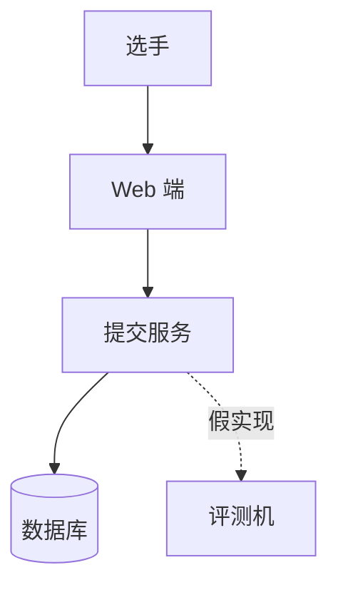

# 架构说明

> 模板：填写后放入 docs/architecture.md

## 模块图

画到"够用"：外部使用者、主要模块、依赖方向。不必画完整类图。

## 模块职责表

| 模块 | 输入 | 输出 | 依赖 | 负责人 |
|---|---|---|---|---|
| 提交服务 | 提交表单 | 提交记录与状态 | 数据库 | |

## 需求 → 模块对照

| 用户故事编号 | 负责模块 | 演示时走这条路径？ |
|---|---|---|
| M1 | 提交服务 | 是 |

没有负责模块的需求要补模块或移入不做；没有对应故事的模块要删。

## 技术选型比选表

| 维度（固定不变） | 候选 A： | 候选 B： |
|---|---|---|
| 组内熟悉度（几人写过） | | |
| 当前环境安装是否便利 | | |
| 与课题示例是否接近 | | |
| 出问题能否一天内定位 | | |

**入选**：　　**入选理由**：
**放弃**：　　**放弃理由**：

### 入选方案风险与对策

| 风险 | 对策 |
|---|---|
| 例：仅一人掌握 / 依赖外部服务 | |
